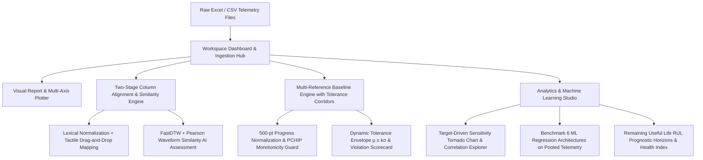
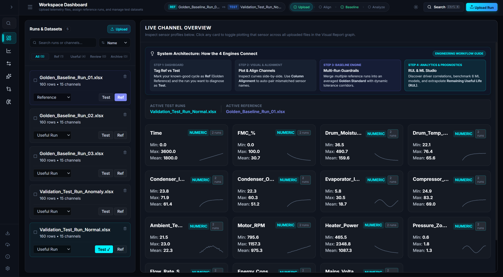
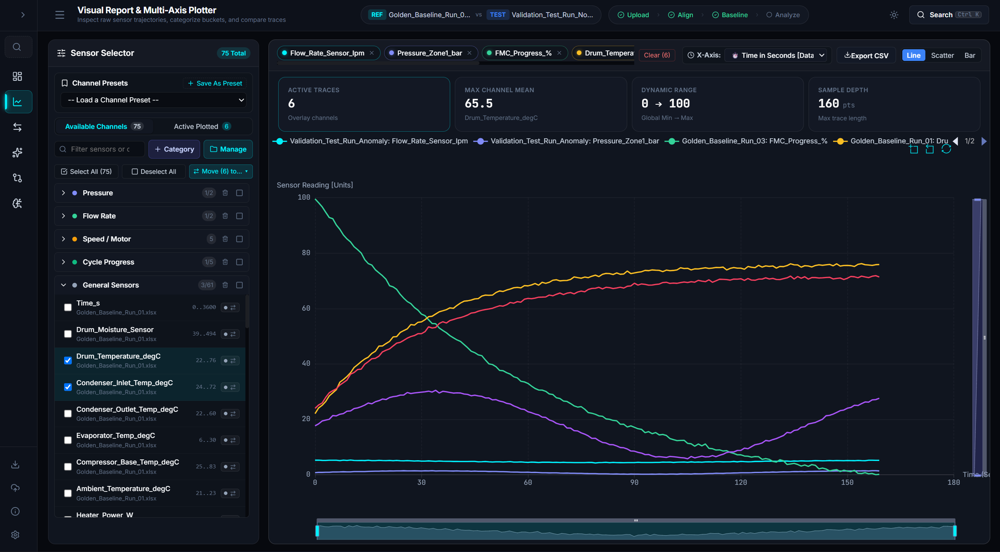
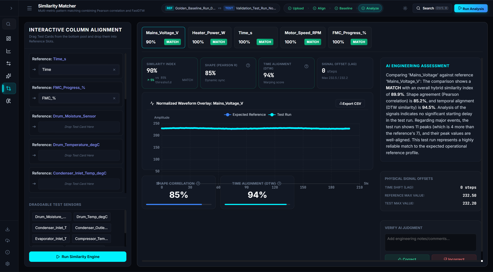
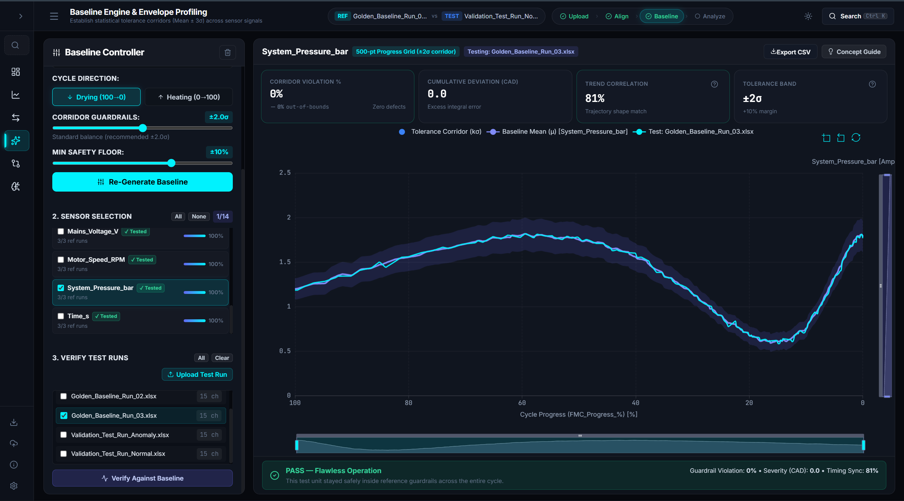
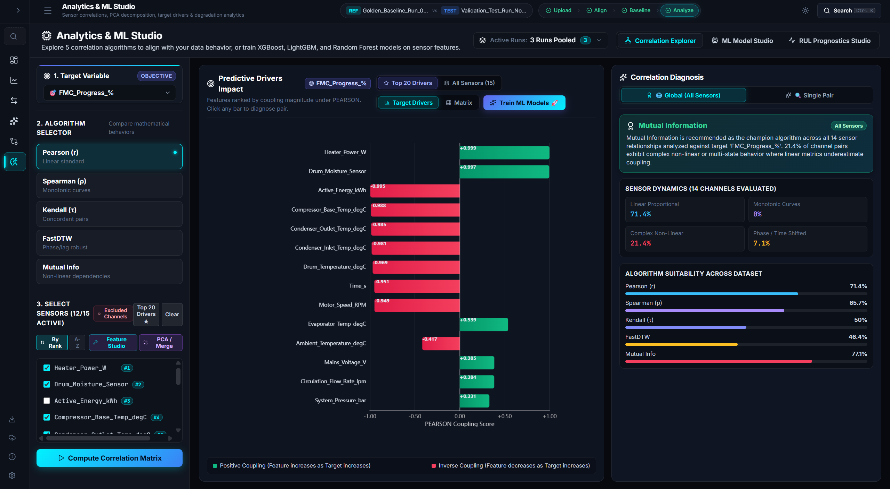
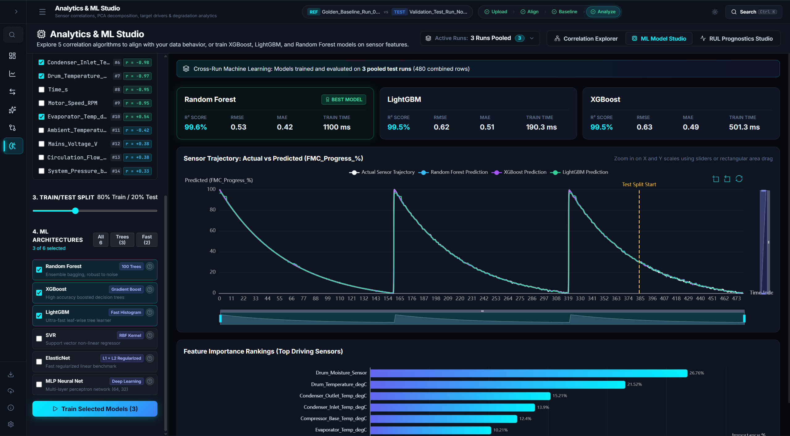
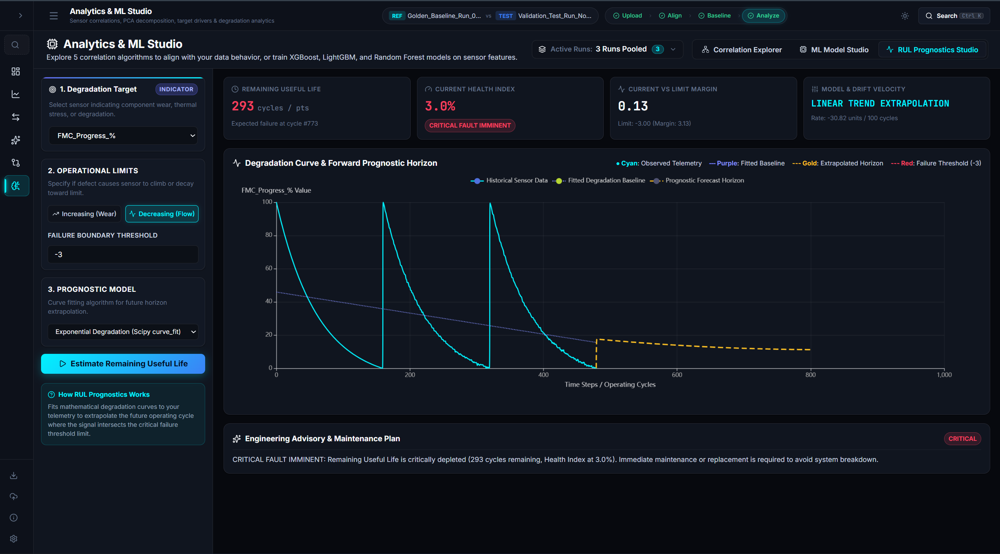

# SensorLens: Enterprise Engineering Guide & Operational Manual
**Advanced Telemetry Analytics, Multi-Run Tolerance Corridors & Prognostic Machine Learning Studio**

---

## 📑 Executive Summary

**SensorLens** is a domain-agnostic, full-stack telemetry analytics workbench architected for hardware validation engineers, quality assurance teams, and R&D laboratory scientists. It transforms raw multi-channel time-series telemetry (recorded in Excel `.xlsx` or CSV formats) into actionable engineering insights, automated pass/fail corridor certifications, and prognostic predictive models.

Because SensorLens operates **domain-agnostically**, it imposes zero rigid assumptions regarding sensor labeling conventions, physical equipment types, or predefined thresholds. Everything from hierarchical sensor categorization and lexical schema alignment to confidence corridors ($\mu \pm k\sigma$) and remaining useful life (RUL) degradation curves adapts dynamically to your ingested datasets.



---

## 🏗️ Technology Architecture & Core Specifications

| Tier | Component | Technology / Stack | Primary Responsibilities |
| :--- | :--- | :--- | :--- |
| **Frontend** | Application Shell & UI | React 19, TypeScript, Vite 8, Vanilla CSS Design System | High-DPI dark glassmorphism workbench, instant hash routing, accessibility, responsive UI scaling |
| **Visualization** | Interactive Chart Engine | Apache ECharts 6.1 (`echarts-for-react`) | 60 FPS multi-trace rendering, dual X/Y range sliders, box-zoom, canvas scatter/line rendering |
| **Interactivity** | Tactile Drag-and-Drop | `@hello-pangea/dnd` | Smooth physics-based channel card mapping between test pool and reference slots |
| **Backend API** | High-Performance Server | Python 3.10+, FastAPI, Uvicorn, Pydantic | In-memory telemetry cache, RESTful endpoints, async file parsing, error handling |
| **Signal Processing** | Numerical Algorithms | NumPy, SciPy (PCHIP monotonic interpolation), Pandas | Resampling on 500-pt uniform grids, signal interpolation, NaN repair, cumulative absolute deviation |
| **Time Alignment** | Non-Linear Alignment | FastDTW, Pearson Correlation ($r$), Levenshtein Distance | Dynamic time warping, phase lag calculation, token-based lexical fuzzy matching |
| **Machine Learning** | Predictive Engine | scikit-learn, XGBoost, LightGBM | Cross-run pooling, 6 regression models, feature importance scoring, exponential degradation fitting |
| **State Sync** | Workspace Persistence | JSON Serialization & OneDrive Export Bridge | Full snapshot export/import of active files, mappings, custom categories, and reports |

---

## 🚀 Quick Launch & Installation Guide

SensorLens includes automated zero-friction launchers for Windows workstations:

### 1. First-Time Setup (`setup_first_time.bat`)
Run once on a newly cloned repository:
1. Detects system Python (3.10+) and Node.js (18+ / 20+ LTS).
2. Creates an isolated Python virtual environment (`backend/.venv`).
3. Installs backend dependencies (`pandas`, `fastapi`, `uvicorn`, `scipy`, `fastdtw`, `xgboost`, `lightgbm`, `scikit-learn`).
4. Installs frontend dependencies via `npm install`.
5. Creates a **SensorLens** shortcut directly on your Windows Desktop.

### 2. Daily Application Launch (`start_sensorlens.bat`)
Double-click **`start_sensorlens.bat`** (or your Desktop shortcut):
- Automatically boots the FastAPI backend on `http://localhost:8000`.
- Launches the Vite React frontend on `http://localhost:5173`.
- Opens your default web browser to the SensorLens Workbench.
- Monitors services in real-time.

### 3. Graceful Termination (`stop_sensorlens.bat`)
Double-click **`stop_sensorlens.bat`** to cleanly release ports 8000 and 5173 and shut down all background worker processes.

---

## 🧭 System Overview: The 5 Core Engines

```
┌────────────────────────────────────────────────────────────────────────────────────────┐
│                                 SENSORLENS WORKBENCH                                   │
├──────────────┬──────────────────┬─────────────────┬─────────────────┬──────────────────┤
│ 1. Dashboard │ 2. Visual Report │ 3. Alignment    │ 4. Baseline     │ 5. Analytics &   │
│    & Runs    │    & Plotter     │    & Similarity │    Corridors    │    ML Studio     │
└──────────────┴──────────────────┴─────────────────┴─────────────────┴──────────────────┘
```

---

## 1. Engine 1: Workspace Dashboard & Ingestion Hub

The **Workspace Dashboard** serves as your mission-control library for ingesting raw run files, categorizing golden cycles versus validation tests, and previewing high-level channel telemetry.



### Key Features & Capabilities
1. **Multi-File Drag-and-Drop Ingestion**:
   - Accepts multiple Excel files (`.xlsx`, `.xls`) or CSV logs simultaneously.
   - Instant in-memory parsing extracting row counts, channel names, statistical summaries (Min, Max, Mean, Std Dev), and 30-point thumbnail sparklines.
2. **Flexible Run Tagging & Multi-Test Comparison Selection**:
   - **Ref (Golden Reference)**: Designate your known-good production cycle or laboratory baseline.
   - **Test ✓ (Multi-Test Selection)**: Click **Test** on one or *multiple* files to select them for simultaneous overlay, comparison, and ML model pooling.
   - **Lifecycle Tags**: Categorize runs as `Useful Run`, `Needs Review`, `Reference`, or `Archive`.
3. **Live Channel Overview & Batch Multi-Run Plotting**:
   - Displays every unique sensor detected across your uploaded files.
   - **Run Count Badges**: Shows run presence (e.g., `In 3 of 3 runs`).
   - **1-Click Batch Plotting**: Clicking any sensor card on the dashboard automatically toggles that sensor across **all uploaded files containing that channel** into the Visual Report graph. A status badge indicates `✓ Plotted (N runs)` or `Partially Plotted`.
4. **Engineering Architecture Roadmap Banner**:
   - Embedded interactive guide explaining how the 4 core analytical stages interconnect.

### Step-by-Step Operating Instructions:
```
[Step 1: Ingest Data]
  └─ Drag and drop your test runs into the "Runs & Datasets" panel on the left (or click "Upload Run").

[Step 2: Assign Reference & Tests]
  ├─ Click "Ref" on your golden reference run (e.g., Golden_Baseline_Run_01.xlsx).
  └─ Click "Test" on all runs you want to evaluate (e.g., Validation_Test_Run_Normal.xlsx and Anomaly.xlsx).

[Step 3: Quick Plot to Visual Report]
  └─ In the "Live Channel Overview" grid, click any sensor card (e.g., "Drum_Temperature_degC").
     Notice the card turns cyan with "✓ Plotted (N runs)". It is now queued on the Visual Report graph!
```

---

## 2. Engine 2: Visual Report & Multi-Axis Plotter

The **Visual Report** is an ultra-responsive engineering plotting workbench powered by Apache ECharts, engineered for inspecting complex waveforms without data loss.



### Key Features & Capabilities
1. **Full-Resolution Lossless Plotting**:
   - Visualizes all $N$ data points from the raw spreadsheet. No downsampling or bezier curve smoothing distortion (`smooth: false`)—peak steps, noise, and sharp transients are faithfully preserved.
2. **Time in Seconds (`Time_s`) / Row Index X-Axis**:
   - The primary horizontal axis reflects **Time in Seconds** (or discrete Excel row data points), avoiding artificial time indices.
   - Dynamic hover tooltip details the exact timestamp and row: `⏱️ Time: 120s (Row 121)` with aligned channel readings.
3. **Sensor-as-X Cross-Plotting**:
   - Switch the X-axis dropdown from `Time in Seconds` to any uploaded sensor channel (e.g., plot `Pressure` vs. `Temperature` to generate thermodynamic hysteresis curves).
4. **Custom Sensor Buckets & Category Manager**:
   - Group hundreds of raw sensors into intuitive engineering categories (e.g., *Thermal Sensors*, *Pressure & Vacuum*, *Motor & Power*, *Cycle Progress*).
   - Create custom buckets, assign distinct color palettes, and use in-line swap buttons (`⇄`) or bulk-move dialogs.
5. **Interactive Stage & Dual-Slider Zoom**:
   - Dual-axis sliders (horizontal time slider + vertical amplitude slider) plus rectangular area zoom.
   - Switch chart types on the fly: **Line**, **Scatter**, or **Bar**.
   - **Export Plotted Channels to CSV**: Downloads the exact synchronized telemetry of all plotted curves for external reporting.

### Step-by-Step Operating Instructions:
```
[Step 1: Open Visual Report]
  └─ Click "Visual Report" in the navigation sidebar (or press hotkey 2).

[Step 2: Select Channels to Overlay]
  ├─ In the left "Sensor Selector", expand any category (e.g., "General Sensors" or "Thermal").
  └─ Check the boxes for channels you wish to compare across files.

[Step 3: Inspect & Zoom]
  ├─ Drag the bottom slider to focus on a specific operating window (e.g., seconds 30 to 120).
  ├─ Use the right vertical slider to inspect small-magnitude sensor oscillations.
  └─ Hover over any point to read synchronized values across all overlaid runs.

[Step 4: Export Filtered Telemetry]
  └─ Click "Export CSV" in the top stage toolbar to export the plotted dataset.
```

---

## 3. Engine 3: Two-Stage Column Alignment & Waveform Similarity Matcher

In multi-bench testing, different DAQ systems often record identical physical parameters under mismatched column headers (e.g., `Drum_Temp_degC` vs. `T_Drum` vs. `Temperature_Drum`). The **Column Alignment & Similarity Matcher** automates and verifies schema pairing.



### Key Features & Capabilities
1. **Two-Stage Intelligent Alignment**:
   - **Stage 1 (Deterministic Lexical Normalization)**: Strips common technical suffixes (`_degC`, `_rpm`, `_bar`, `_w`, `_v`), normalizes delimiters (`_`, `-`, spaces), and calculates string similarity via Levenshtein distance ($\ge 0.85$ auto-mapped).
   - **Stage 2 (Tactile Drag-and-Drop Bank)**: Unassigned channels sit in an interactive bottom pool. Simply drag test cards into reference slots or swap them freely.
2. **Dynamic Mathematical Pair Scoring**:
   - When a channel is mapped, SensorLens instantly computes:
     - **Pearson Correlation ($r$)**: Shape agreement and directional trend synchronization.
     - **FastDTW Distance**: Temporal alignment robust to non-linear operational stretching or cycle compression.
     - **Signal Offsets**: Detects phase shift (lag in time steps) and amplitude scaling differences ($Max_{ref}$ vs. $Max_{test}$).
3. **AI Engineering Assessment**:
   - Automatically generates a comprehensive technical evaluation paragraph assessing waveform match quality, phase delays, peak alignments, and compliance verdicts (`MATCH`, `SIMILAR`, `REQUIRES REVIEW`).
4. **Human-in-the-Loop Feedback Logger**:
   - Engineers can click **Correct** or **Incorrect** and log technical notes to calibrate alignment thresholds.

### Step-by-Step Operating Instructions:
```
[Step 1: Open Column Alignment]
  └─ Click "Alignment" in the sidebar navigation.

[Step 2: Review Suggested Auto-Mappings]
  └─ SensorLens displays automatic pairings in the left slot rack. Green badges denote confident lexical matches.

[Step 3: Manually Map Unassigned Channels]
  ├─ Locate unassigned test channels in the "Draggable Test Sensors" tray at the bottom.
  └─ Drag a test sensor card and drop it directly onto the target Reference Slot.

[Step 4: Execute Waveform Similarity Engine]
  ├─ Click "Run Similarity Engine" (cyan button).
  ├─ Review the "Normalized Waveform Overlay" comparing Expected Reference vs. Test Run curves.
  └─ Read the "AI Engineering Assessment" on the right panel for automated pass/review diagnostics.
```

---

## 4. Engine 4: Multi-Reference Baseline Engine with Tolerance Corridors

Single-reference comparisons often trigger false alarms due to natural machine-to-machine production variance. The **Baseline Engine** merges *multiple* golden runs into an averaged statistical corridor with dynamic tolerance guardrails.



### Key Features & Capabilities
1. **Multi-Run Golden Standard Aggregation**:
   - Ingests multiple reference cycles (e.g., `Run_01`, `Run_02`, `Run_03`) simultaneously to compute the true mean profile $\mu(t)$ and standard deviation $\sigma(t)$.
2. **Progress Variable Normalization (500-pt Uniform Grid)**:
   - Resamples non-uniform temporal cycles against an operational progress variable (e.g., Cycle Progress %, Moisture Content `FMC%`, or Temperature Rise).
   - Interpolates all curves onto a unified 500-point normalized progress grid ($0 \to 100\%$ or $100 \to 0\%$).
3. **Monotonicity Guard & PCHIP Repair**:
   - Detects signal noise or momentary sensor jitter reversals in the progress metric.
   - Minor reversals ($< 2\%$) are automatically repaired using shape-preserving **Piecewise Cubic Hermite Interpolating Polynomials (PCHIP)**. Severe reversals ($> 2\%$) trigger safety rejection warnings.
4. **Dynamic Tolerance Envelopes ($\mu \pm k\sigma$)**:
   - Shaded tolerance ribbon adjustable via the **Corridor Guardrails Slider** ($\pm 1.0\sigma$ to $\pm 4.0\sigma$).
   - **Minimum Safety Floor**: Configurable percentage margin (e.g., $\pm 10\%$) preventing corridor collapse in ultra-stable operational zones.
5. **Defect Quantification Scorecard**:
   - **Corridor Violation %**: Percentage of test cycle operating outside guardrails ($0\% = \text{Flawless PASS}$).
   - **Cumulative Absolute Deviation (CAD)**: Integrated excess area of out-of-bounds excursions.
   - **Trend Correlation**: Overall shape fidelity against the golden mean trajectory.

### Step-by-Step Operating Instructions:
```
[Step 1: Select Reference Baseline Pool]
  └─ On the Dashboard, ensure 2 or more golden reference files are tagged as "Reference".

[Step 2: Open Baseline Engine]
  └─ Navigate to "Baseline Engine" in the sidebar.

[Step 3: Configure Normalization & Guardrails]
  ├─ Select Cycle Direction: "Drying (100 -> 0)" or "Heating (0 -> 100)".
  ├─ Adjust the Corridor Guardrails slider (default ±2.0σ is recommended).
  ├─ Adjust the Min Safety Floor slider (e.g., ±10%).
  └─ Click "Re-Generate Baseline".

[Step 4: Verify Test Runs Against Corridor]
  ├─ Under "3. Verify Test Runs", check the test dataset you wish to audit.
  ├─ Click "Verify Against Baseline".
  └─ Observe the shaded corridor and test curve overlay.
     Check the bottom banner: "PASS — Flawless Operation" or "FAIL — Out-of-Bounds Excursion Detected".
```

---

## 5. Engine 5: Analytics & Machine Learning Studio

The **Analytics & ML Studio** unites mathematical correlation analysis, 6 machine learning architectures, and prognostic degradation forecasting.

### 5A. Correlation Explorer & Predictive Sensitivity Tornado Chart


1. **Target-Driven Sensitivity Analysis**:
   - Choose a target sensor objective (e.g., `FMC_Progress_%` or `Drum_Temperature_degC`).
   - The backend ranks all other channels by direct predictive coupling $|M[\text{target}, \text{feature}]|$.
2. **Predictive Drivers Tornado Chart**:
   - Diverging horizontal bar visualization:
     - **Emerald Green (`+`)**: Positive coupling (feature increases as target rises).
     - **Rose Red (`-`)**: Inverse coupling (feature decreases as target rises).
   - Click any bar to open an instant pairwise diagnostic (scatter plot, non-linearity test, lag analysis).
3. **5 Mathematical Correlation Algorithms**:
   - **Pearson ($r$)**: Standard linear proportionality.
   - **Spearman ($\rho$)**: Monotonic rank curves.
   - **Kendall ($\tau$)**: Concordant pair robust statistics.
   - **FastDTW**: Non-linear temporal phase-lag robustness.
   - **Mutual Information**: Detects complex non-linear and multi-state dependencies.
4. **Champion Algorithm Recommendation**:
   - The diagnosis engine analyzes sensor dynamics (linear, monotonic, non-linear, phase-shifted) and automatically recommends the most statistically appropriate algorithm.
5. **1-Click ML Training Bridge**:
   - Click **"Train ML Models with Drivers 🚀"** on the Tornado header to immediately transfer top drivers into the ML Model Studio!

---

### 5B. Machine Learning Model Benchmark Studio


1. **Cross-Run Pooled Telemetry Training**:
   - Trains models across multiple selected test cycles simultaneously (e.g., 3 pooled runs = 480 combined time steps).
2. **Benchmark 6 Machine Learning Architectures**:
   - **Random Forest**: Ensemble bagging, highly robust to sensor noise.
   - **XGBoost**: Extreme gradient boosted decision trees.
   - **LightGBM**: Ultra-fast leaf-wise tree learner.
   - **Support Vector Regressor (SVR)**: Non-linear RBF kernel mapping.
   - **ElasticNet**: L1/L2 regularized linear baseline.
   - **MLP Neural Network**: Deep multi-layer perceptron architecture.
3. **Train / Test Split Slider**:
   - Configure split ratio (e.g., 80% Training / 20% Out-of-Sample Validation).
4. **Model Performance Scorecards**:
   - Compares models side-by-side: $R^2$ Score, RMSE, MAE, and Training Time in milliseconds. Automatically tags the **BEST MODEL**.
5. **Sensor Trajectory: Actual vs. Predicted Overlay**:
   - Interactive ECharts curve plotting the ground truth sensor telemetry against model predictions across all operating cycles, with a yellow vertical dashed divider marking **Test Split Start**.
6. **Feature Importance Rankings**:
   - Horizontal bar breakdown showing the percentage contribution of each physical sensor to model predictions.

---

### 5C. Remaining Useful Life (RUL) Prognostics Studio


1. **Prognostic Wear & Degradation Modeling**:
   - Select a critical wear parameter (e.g., Moisture Removal Efficiency, Heating Resistance, Compressor Pressure).
   - Set the **Failure Boundary Threshold** and degradation direction (`Increasing Wear` vs. `Decreasing Flow/Efficiency`).
2. **Mathematical Horizon Extrapolation**:
   - Fits degradation models (Exponential Decay/Growth via `scipy.optimize.curve_fit`, Linear Drift, or Polynomial) across operational cycles.
   - Forecasts the future trajectory (gold dashed line) until it intersects the critical failure boundary threshold (red dashed line).
3. **Prognostic Scorecard & Health Index**:
   - **Remaining Useful Life (RUL)**: Estimated operating cycles/hours remaining before failure.
   - **Current Health Index %**: Real-time asset health state ($100\% = \text{New}, \le 10\% = \text{Critical Fault Imminent}$).
   - **Drift Velocity**: Quantitative rate of physical degradation per 100 operating cycles.
4. **Engineering Advisory & Maintenance Action Plan**:
   - Automated maintenance recommendations with severity alerts (`HEALTHY`, `SCHEDULE MAINTENANCE`, `CRITICAL FAULT IMMINENT`).

---

## 🛠️ Step-by-Step Guided Engineering Scenarios

### Scenario A: Auditing a New Prototype Run Against Golden Standard
```
Objective: Verify if prototype "Validation_Test_Run_Anomaly.xlsx" conforms to golden reference limits.

1. Launch SensorLens (double-click start_sensorlens.bat).
2. On the Dashboard:
   - Mark "Golden_Baseline_Run_01.xlsx" as Ref.
   - Mark "Validation_Test_Run_Anomaly.xlsx" as Test ✓.
3. Navigate to "Baseline Engine" in the sidebar.
4. Set Corridor Guardrails to ±2.0σ and Min Safety Floor to ±10%. Click "Re-Generate Baseline".
5. Under "Verify Test Runs", select "Validation_Test_Run_Anomaly.xlsx" and click "Verify Against Baseline".
6. Result:
   - SensorLens highlights the exact heating failure between cycle progress 45% and 20%.
   - Scorecard displays: Corridor Violation = 14.2%, Status = DEFECT DETECTED.
```

### Scenario B: Auto-Pairing Mismatched DAQ Channel Names
```
Objective: Reconcile mismatched sensor tags between DAQ Bench A and DAQ Bench B.

1. Navigate to "Alignment" in the sidebar.
2. Observe Stage 1 Lexical Matching:
   - "Drum_Temp_degC" automatically pairs to "Drum_Temperature_degC" (Confidence: 94%).
3. Inspect unassigned channels in the bottom tray.
4. Drag "Flow_Sensor_lpm" and drop it into Reference Slot "Circulation_Flow_Rate_lpm".
5. Click "Run Similarity Engine".
6. Read the AI Engineering Assessment to verify temporal sync (DTW score > 90%).
```

### Scenario C: Training Machine Learning to Predict Cycle Progress
```
Objective: Train ML models to predict moisture removal progress from thermodynamic sensors.

1. Navigate to "Analytics & ML Studio" -> "Correlation Explorer".
2. Set Target Variable to "FMC_Progress_%".
3. Review the Tornado Chart showing top driving sensors (Heater Power, Moisture Sensor, Condenser Temp).
4. Click "Train ML Models with Drivers 🚀".
5. The workbench switches to "ML Model Studio" with top drivers pre-selected.
6. Select architectures: Random Forest, LightGBM, XGBoost. Set Split to 80/20.
7. Click "Train Selected Models (3)".
8. Compare scorecards: Random Forest achieves R² = 99.6% with 0.53 RMSE.
9. Inspect the Feature Importance chart to document primary thermodynamic drivers.
```

---

## 💾 Workspace Persistence & OneDrive Cloud Synchronization

SensorLens allows seamless preservation and team sharing of your analytical state:

1. **Local Session Export / Import**:
   - Click the **Save / Export** icon in the bottom sidebar.
   - Downloads a portable `.json` session bundle containing all uploaded datasets, column mappings, baseline profiles, and notes.
   - Click the **Import** icon anytime to restore the entire workspace instantly.
2. **OneDrive Enterprise Synchronization**:
   - In **Settings** (gear icon), configure your enterprise OneDrive or SharePoint local sync directory (e.g., `C:\Users\Username\OneDrive - Enterprise\SensorLensReports`).
   - Click **Export to OneDrive** in the application menu. SensorLens automatically writes structured JSON session files and Markdown summary reports directly to your team folder.

---

## 🧪 Synthetic Test Datasets Generator

To explore SensorLens immediately without proprietary data, use the built-in dataset generators:

```bash
# Generate 5 realistic demonstration datasets in demo_datasets/
python generate_demo_showcase_data.py
```
This generates:
- `Golden_Baseline_Run_01.xlsx`, `02.xlsx`, `03.xlsx`: Reference baseline runs with natural manufacturing variance.
- `Validation_Test_Run_Normal.xlsx`: Compliant test run with alternative schema names.
- `Validation_Test_Run_Anomaly.xlsx`: Defective test run with injected heating element anomaly and delayed moisture curve.

---

## 💡 Gemini Enterprise Prompting Cheatsheet

When this document and raw run files are uploaded to **Gemini Enterprise**, you can use these prompt templates for instant expert guidance:

| Objective | Recommended Gemini Enterprise Prompt |
| :--- | :--- |
| **Corridor Audit Interpretation** | *"Based on the SensorLens Enterprise Guide, my Baseline Engine test shows a Corridor Violation of 12.4% and CAD of 45.2 on Drum_Temperature. What does this indicate and what physical defect should I inspect?"* |
| **Algorithm Selection** | *"I have sensor data with significant non-linear phase shifts and valve delays. According to the SensorLens manual, which correlation algorithm and similarity metric should I choose, and why?"* |
| **ML Model Selection** | *"Explain the trade-offs between the 6 ML models in SensorLens for predicting sensor trajectories based on the architecture table in this document."* |
| **RUL Degradation Forecast** | *"How does SensorLens calculate the Health Index and Remaining Useful Life (RUL) in the Prognostics Studio? Walk me through the mathematical degradation extrapolation steps."* |
| **Channel Categorization** | *"Generate a JSON bucket configuration following the SensorLens bucketUtils schema to categorize 40 industrial sensor channels into Thermal, Pressure, Electrical, and Fluidic buckets."* |

---

*SensorLens &copy; 2026. Designed for advanced telemetry analytics, baseline validation, and industrial prognostic engineering.*
